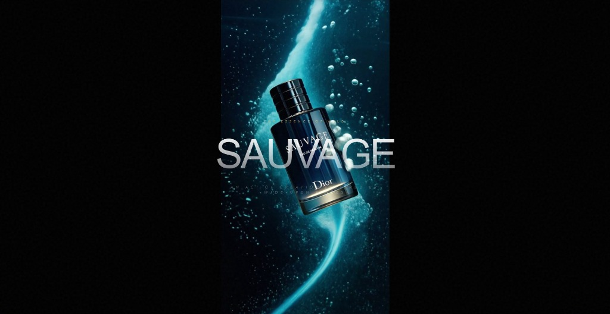

# Dior Sauvage — Experiência Digital Cinemática

Aplicação web desenvolvida para demonstrar técnicas de desenvolvimento assistido por Inteligência Artificial (Vibe Coding) com foco em alta performance e fidelidade visual.



---

## Visão Geral

Lojas virtuais e catálogos digitais de artigos de luxo frequentemente sofrem com carregamentos pesados, vídeos estáticos mal otimizados e layouts genéricos que não transmitem o valor da marca. 

Este projeto explora uma abordagem orientada à experiência: a rolagem de página controla diretamente a taxa de quadros da animação do produto, criando uma navegação imersiva e contínua a 60 quadros por segundo.

---

## Decisões de Design e Engenharia de Prompt

O desenvolvimento foi conduzido através de prompts técnicos avançados, aplicando regras de design determinístico para evitar vícios comuns de interfaces geradas por IA (gradientes saturados, elementos puramente centralizados ou tipografia sem personalidade):

- **Paleta monocromática estrita**: Fundo escuro absoluto (#010103) com contraste tipográfico rigoroso.
- **Hierarquia tipográfica**: Combinação intencional entre Playfair Display (editorial) e Lato (funcional).
- **Controle de layout e estabilidade visual**: Utilização de unidades dinâmicas de viewport (100dvh) para evitar saltos de layout (CLS) em dispositivos móveis.
- **Skills de contexto aplicadas**: Diretrizes das skills `taste-skill` e `impeccable-design`.

---

## Funcionalidades Técnicas

- **Canvas Frame Scrubbing**: Renderização sequencial de 240+ frames sincronizada à velocidade de rolagem do usuário via GSAP ScrollTrigger.
- **Rolagem Inercial Suave**: Gerenciamento de física de scroll com a biblioteca Lenis.
- **Camada Texturizada Procedural**: Overlay de ruído analógico gerado via filtro SVG sem impacto de download de mídia externa.
- **Divisão de Código**: Módulos abaixo da dobra carregados sob demanda com `React.lazy` e `Suspense`.
- **Estratégia de LCP**: Elemento proxy dedicado para pintura inicial imediata.

---

## Tecnologias Utilizadas

- **Frontend**: React 18
- **Build Tool**: Vite 5
- **Estilização**: Tailwind CSS v3
- **Animação e Física de Scroll**: GSAP 3 (ScrollTrigger), Lenis Scroll
- **Ícones**: Lucide React

---

## Estrutura do Projeto

```text
site-perfume/
├── assets/                  # Imagens e materiais de documentação
├── public/
│   ├── frames/              # Sequência de quadros para a animação do canvas
│   ├── card-main.webp       # Visual principal da campanha
│   └── hero_master.mp4      # Vídeo de referência em alta definição
├── src/
│   ├── components/          # Componentes de seção, hero e scroll
│   ├── App.jsx              # Composição principal em camadas
│   ├── main.jsx             # Ponto de entrada da aplicação
│   └── index.css            # Estilos base e aceleração por hardware
├── package.json
└── vite.config.js
```

---

## Instalação e Execução Local

### Pré-requisitos
- Node.js 18 ou superior
- Gerenciador de pacotes npm

### Passos

1. Clonar o repositório:
```bash
git clone https://github.com/SEU-USUARIO/dior-sauvage-experience.git
cd dior-sauvage-experience
```

2. Instalar dependências:
```bash
npm install
```

3. Iniciar o servidor de desenvolvimento:
```bash
npm run dev
```
Acesse `http://localhost:5173` no navegador.

4. Gerar build de produção:
```bash
npm run build
```

---

## Limitações Conhecidas e Próximos Passos

- **Escopo atual**: Interface conceitual focada em experiência de marca; não possui integração ativa com gateway de pagamento ou estoque.
- **Próximas melhorias**:
  - Integração com backend headless (Shopify Storefront API).
  - Otimização adaptativa de formato de imagem baseada na velocidade de rede do cliente.

---

## Licença

Distribuído sob a licença MIT. Consulte o arquivo `LICENSE` para mais informações.
